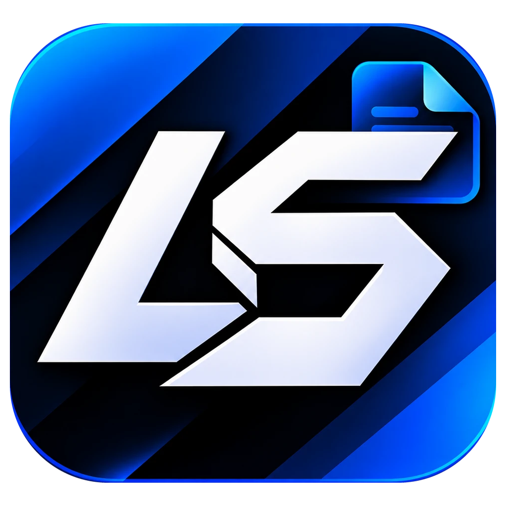

<p align="center">
  
</p>

<h1 align="center">Lsync</h1>

<p align="center">
  Converter arquivos, baixar vídeos e editar imagens no Windows, num programa só.<br>
  Gratuito, sem anúncios e em português, inglês ou espanhol.
</p>

<p align="center">
  <a href="https://github.com/LS-Corporation/lsync/releases/latest/download/Lsync-Setup.exe"><b>Baixar o Lsync para Windows</b></a>
</p>

---

## Instalação

1. Clique em **[Baixar o Lsync para Windows](https://github.com/LS-Corporation/lsync/releases/latest/download/Lsync-Setup.exe)**. O arquivo `Lsync-Setup.exe` vai para a sua pasta de Downloads.
2. Abra o arquivo e clique em **Avançar** até terminar.
3. Pronto. O Lsync aparece na área de trabalho e no menu Iniciar.

Na primeira vez, o Windows pode mostrar o aviso "O Windows protegeu o computador". Isso acontece com programas que não têm assinatura digital paga. Clique em **Mais informações** e depois em **Executar assim mesmo**.

Para desinstalar, vá em **Configurações > Aplicativos**, procure "Lsync" e clique em Desinstalar.

Prefere não instalar nada? Baixe o [Lsync-Portatil.zip](https://github.com/LS-Corporation/lsync/releases/latest/download/Lsync-Portatil.zip), extraia a pasta e abra o `Lsync.exe` que está dentro dela.

## Ferramentas

- **Converter arquivos**:
  - imagens: PNG, JPG, WEBP, GIF, AVIF, HEIC, ICO, BMP, TIFF e outros, inclusive quadros de vídeos;
  - PDF: transformar páginas em imagens, juntar vários PDFs, separar as páginas e juntar várias imagens num PDF só;
  - planilhas: Excel (XLSX) para CSV e CSV para Excel;
  - Word para PDF (precisa do Microsoft Word instalado).
- **Converter áudio e vídeo**: MP4, MKV, WEBM, AVI, MOV, WMV, MP3, WAV, FLAC, M4A, OGG e outros.
- **Baixar vídeos**: YouTube, TikTok, Instagram, X, Facebook e outros sites. Mostra a miniatura antes de baixar, baixa até 50 links de uma vez e pode comprimir o vídeo depois.
- **Redimensionar e cortar**: muda o tamanho de várias imagens de uma vez, tira bordas automaticamente ou corta a área que você marcar.
- **Cores**: brilho, contraste, saturação, matiz, temperatura, nitidez, preto e branco, sépia e colorir foto preto e branco, com prévia ao vivo.
- **Remover fundo**: em breve.

## Como usar

1. Escolha a ferramenta no menu da esquerda.
2. Arraste os arquivos para a área tracejada ou clique nela para escolher. Dá para colocar vários de uma vez.
3. Ajuste as opções.
4. Clique no botão azul no canto de baixo.

Os arquivos prontos ficam em `Downloads\Lsync`. Para mudar a pasta, use o campo **Salvar em** ou vá em **Configurações**. O arquivo original nunca é alterado.

### Baixar vídeos

Cole o link e o Lsync mostra a miniatura, o título e a duração, para você conferir se é o vídeo certo. Para baixar vários, escolha **Vários (até 50)** e cole um link por linha.

Marque **Comprimir o vídeo depois de baixar** para o arquivo ficar menor. A imagem continua com a mesma qualidade visível e o áudio não é alterado. A opção fica salva para os próximos downloads.

No primeiro link do YouTube, o Lsync baixa sozinho um componente que o YouTube exige (cerca de 40 MB). Quando o YouTube, o TikTok ou outro site muda, o Lsync atualiza o baixador sozinho. Se quiser, dá para atualizar na hora em **Configurações > Baixador de vídeos**.

Vídeos privados ou que exigem login não podem ser baixados.

### Notificações

Se você deixar um lote rodando e minimizar o Lsync, aparece uma notificação do Windows quando terminar. Dá para desligar em **Configurações**.

### Idioma e tema

Em **Configurações**, no canto inferior esquerdo, dá para trocar o idioma, o tema (claro, escuro ou o do sistema) e a pasta padrão.

## Requisitos

- Windows 10 ou 11, 64 bits.
- Cerca de 500 MB de espaço livre.
- Internet só para baixar vídeos e, na primeira vez que usar "colorir foto", para baixar o modelo de IA (cerca de 125 MB).

## Para desenvolvedores

Precisa do [Python](https://www.python.org/downloads/) 3.10 a 3.13.

```bash
git clone https://github.com/LS-Corporation/lsync.git
cd lsync
python -m venv .venv
.venv\Scripts\activate
pip install -r requirements.txt
python main.py
```

Testes: `python tests/smoke_test.py`

Gerar o programa e o instalador: rode `packaging\build.bat`. O instalador precisa do [Inno Setup](https://jrsoftware.org/isinfo.php).

Organização das pastas:

```
assets/      ícone e logo
lsync/core/  conversões, downloads e efeitos
lsync/ui/    interface (Qt)
packaging/   arquivos para gerar o .exe e o instalador
tests/       testes
tools/       scripts de apoio (ícone e traduções)
```

## Uso responsável

Baixe apenas vídeos que você tem direito de baixar e respeite os termos de uso de cada site.

## Licença

MIT. O Lsync usa projetos de terceiros com licenças próprias, entre eles [Qt/PySide6](https://www.qt.io/qt-for-python) (LGPL), [FFmpeg](https://ffmpeg.org) (GPL), [yt-dlp](https://github.com/yt-dlp/yt-dlp), [Pillow](https://python-pillow.org), [OpenCV](https://opencv.org), [pypdfium2](https://github.com/pypdfium2-team/pypdfium2), [pypdf](https://github.com/py-pdf/pypdf) e [openpyxl](https://openpyxl.readthedocs.io). O modelo de colorização é de [Zhang et al.](https://github.com/richzhang/colorization) (BSD-2).
